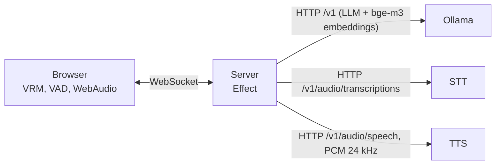

# Sofia — real-time Italian AI avatar

Speak or type Italian; a 3D VRM avatar answers aloud with lip-sync, grounded in a knowledge base (RAG).
Open-source models only, [Effect](https://effect.website) 4 + TypeScript 7.



Full diagrams (components and one turn): [docs/architecture.md](docs/architecture.md).

Terms are defined in [GLOSSARY.md](GLOSSARY.md); decisions in [docs/adr](docs/adr).

## Requirements

- **Docker** with Compose v2 (or, to run by hand: Node 24+, pnpm 12, Python 3.11+).
- **Ollama** running on the host, reachable from containers at `http://host.docker.internal:11434`
  (macOS/Windows Docker Desktop work out of the box; on Linux Compose adds the host gateway for you).
  Pull the models first: `ollama pull qwen3.6:35b-a3b` and `ollama pull bge-m3`.
  The default LLM is a 35B mixture-of-experts model, so it needs roughly 24 GB of free memory (Apple Silicon M-series or a GPU);
  on smaller machines set `LLM_MODEL` to a smaller Ollama model.
- **Browser**: current Chrome, Edge or Firefox with WebGL2 and WebAssembly. Open it on `localhost`
  (the microphone needs a secure context; plain `http://<lan-ip>` blocks it) and allow microphone access.
- **Disk and network**: about 3 GB of images plus about 600 MB of speech models and the 10 MB avatar,
  downloaded on first start (Docker Hub, Hugging Face, GitHub), so the first start needs internet.
- **CPU**: no GPU needed for speech. STT and TTS run on CPU, so 4+ cores keep voice latency reasonable.
- **Free ports**: 3000, 5173, 8001, 8002.

## Run it with Docker Compose

```bash
docker compose up --build   # stt :8001, tts :8002, server :3000, web :5173; then open http://localhost:5173 and press Avvia
```

`./knowledge` is mounted into the server (read-only), so you can edit passages and run `docker compose restart server`; `KNOWLEDGE_FILE=other.json` picks another file. Inside the dev container the host path comes from `$HOST_WORKSPACE_FOLDER`; on a plain checkout it falls back to `.`.

Ollama stays on the host (`OLLAMA_URL`, `LLM_MODEL` can be overridden). Speech models download into a volume on first start.

## Run it by hand (everything in the dev container, CPU speech models)

```bash
pnpm install
./infra/setup.sh && ./infra/run.sh &                  # STT :8001 (faster-whisper small), TTS :8002 (Piper it_IT)
pnpm --filter @avatar/web prepare-assets              # VAD models + sample avatar (VRM 1.0, pixiv, redistributable)
OLLAMA_URL=http://host.docker.internal:11434 STT_URL=http://localhost:8001 TTS_URL=http://localhost:8002 \
  pnpm --filter @avatar/server start                  # :3000  (/ws, /health)
pnpm --filter @avatar/web dev                         # :5173  open it, press Avvia
```

Server env: `OLLAMA_URL`, `LLM_MODEL` (default `qwen3.6:35b-a3b`), `EMBED_MODEL` (`bge-m3`), `KNOWLEDGE_FILE`,
`STT_URL`, `TTS_URL`, `TTS_VOICE`, `PORT`. Without `STT_URL` voice input is off; without `TTS_URL` replies are silent.

Ollama must be reachable and have the models: `ollama pull bge-m3` and your LLM. Keep the model loaded (`keep_alive` is set on warm-up).

## Better speech on the Mac host

The CPU servers are only the default. Anything with the same HTTP shape works, so run faster models on the M4 and point
`STT_URL` / `TTS_URL` at them (e.g. `http://host.docker.internal:PORT`):

- STT: `whisper.cpp` server or an MLX Whisper server exposing `POST /v1/audio/transcriptions` (multipart, `file`, `language=it`).
- TTS: Kokoro-FastAPI (Italian voices `if_sara`, `im_nicola`) with `POST /v1/audio/speech`, `response_format=pcm`; set `TTS_VOICE=if_sara`.

## Tests and proofs

| Command | What it proves |
|---|---|
| `pnpm test` | unit tests (chunker, Turn, Session, protocol, lip-sync, speech helpers, server connection with a fake socket) |
| `pnpm typecheck` | all packages on TypeScript 7 |
| `pnpm eval` | model eval: retrieval, fact recall, refusals, injection, Italian, latency, with pass/fail gates |
| `pnpm e2e` | live stack over WebSocket: text turn, voice turn, barge-in, history; reply audio is transcribed back with STT |
| `pnpm e2e:browser` | real client in headless Chromium: fake microphone, VAD, lip-sync, barge-in, acks; screenshots in [docs/proof/](docs/proof/) |

`pnpm e2e:browser` needs `./infra/browser-setup.sh` once (Chromium + libs without root), plus the web dev server running.
